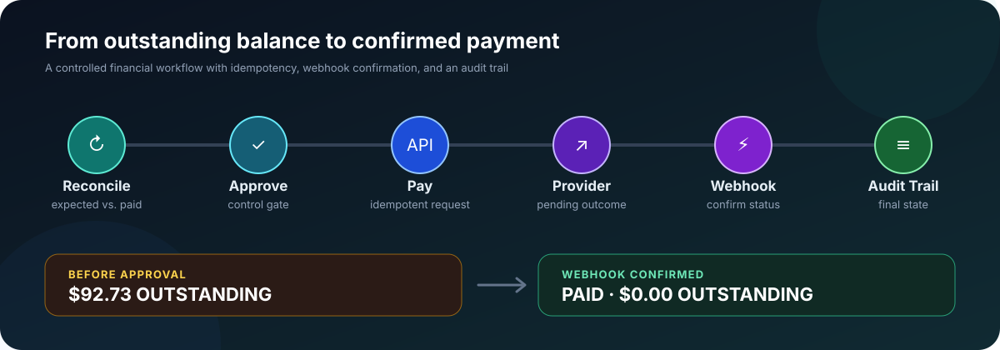
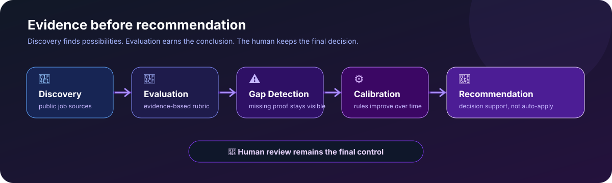
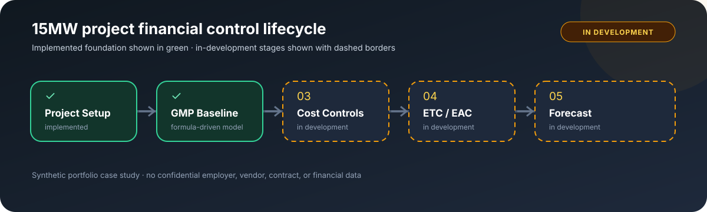
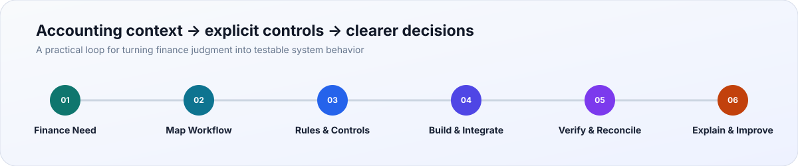

# Hi, I'm Sherry 👋

### 💰 Finance × ⚙️ Systems × 🤖 AI

I build systems that turn complex financial and operational workflows into structured, automated, and measurable processes.

My work connects financial operations, workflow design, APIs and automation, and human-in-the-loop AI systems.

---

## Featured Systems

### 💸 Creator Payout & Reconciliation

An end-to-end finance operations system that translates payout agreements and accounting rules into validated calculations, reconciliation, approval controls, and traceable payment states. It surfaces exceptions for review, prevents duplicate requests, and verifies final outcomes through webhooks and **60 automated tests**.

`Python` `Financial Controls` `Reconciliation` `Idempotency` `Webhooks` `Pytest`

**[View Project →](https://github.com/SherryHuProducts/creator-payout-ops)**

---

### 🤖 JobFit AI

Although the domain is job search, this project demonstrates how I build and evaluate AI-assisted workflows: define explicit stages, preserve source evidence, expose unsupported conclusions, and keep high-impact decisions under human review. My public extension adds web-candidate intake, evaluation handoff, provenance-checked resume tailoring, document rendering, and automated tests.

`Node.js` `Public ATS APIs` `Evaluation Contracts` `Provenance Checks` `Document Rendering` `Automated Tests`

**[View Project →](https://github.com/SherryHuProducts/JobFit-AI)**

---

### 🏗️ 15MW Data Center Financial Controls · `IN DEVELOPMENT`

A synthetic 15MW construction case study that turns project financial data into structured budget, cost-control, and forecast workflows. The implemented project setup and formula-driven GMP baseline establish a common financial language for project and finance teams; cost controls, ETC/EAC, and forecasting remain in development.

`Excel` `Project Accounting` `GMP Baseline` `Cost Control Design` `ETC / EAC` `Forecast Design`

**[View Project →](https://github.com/SherryHuProducts/data-center-project-accounting-case-study)**

---

## What I Build

<table>
  <tr>
    <td width="50%">
      <h3>💰 Financial & Accounting Systems</h3>
      
Reliable calculations, reconciliation, forecasting, and supporting evidence.

    </td>
    <td width="50%">
      <h3>⚙️ Workflow Automation</h3>
      
Less manual handling, faster review, and clear approval and exception paths.

    </td>
  </tr>
  <tr>
    <td width="50%">
      <h3>🔌 Backend & Integrations</h3>
      
Finance workflows connected to APIs and webhooks with traceable state.

    </td>
    <td width="50%">
      <h3>🤖 AI Evaluation & Controls</h3>
      
Realistic cases, acceptance criteria, failure diagnosis, and human approval.

    </td>
  </tr>
</table>

## How I Think

> I translate accounting judgment into explicit requirements, controls, and acceptance criteria that technical teams can build—and non-finance partners can understand.

## Technology

| Area | Selected tools and methods |
|---|---|
| **Finance & accounting** | Reconciliation · Project accounting · Budgeting · Forecasting · Exception review |
| **Systems & automation** | Python · JavaScript / Node.js · REST APIs · Webhooks · CSV / JSON · Excel |
| **Evaluation & controls** | Requirements mapping · Acceptance criteria · Human review · Provenance · Automated tests |
| **Communication** | Decision-ready explanations · Cross-functional handoffs · Clear review paths |
